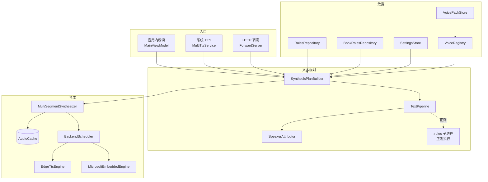

# 架构与行为约定

本文是当前实现与行为契约的维护入口，描述模块、数据流、交互和设计取舍；替代原内部功能说明。功能摘要见 [README](../README.md)，总目标见[路线图](ROADMAP.md)。执行步骤与验证缺口分别保存在本机 `docs/PLAN.md`、`docs/ISSUES.md`；下文 `I-xxx` 为本机问题编号，克隆后不要求这些文件存在。这里描述“实现如何工作”，不表示每项都已经真机验收；修改与回归要求见[开发手册](DEVELOPMENT.md)。

## 设计目标

- **自己发声**：导入语音包后由本应用的后端直接合成，而不是把请求转发给设备上的另一个 TTS 引擎。
- **三个入口，一条链路**：应用内朗读、Android 系统 TTS、HTTP 转发共用同一套规则、音色注册表和合成器，同样的输入得到同样的音频。
- **可解释的多角色朗读**：当前角色来自人工书籍人物表与全局规则，不使用大模型识别人物；声音池为未绑定人物分配并持久保存声音。按用户选定的无归属策略处理连续对话，最终没有匹配时用默认对话音色，并显示不确定依据。自动发现人物尚未实现。
- **不丢用户数据**：规则、设置和语音包的每次写入都可回滚；读取失败时暴露错误，不用空配置覆盖。

产品范围与暂缓方向见[路线图](ROADMAP.md)。

## 技术栈

| 项目 | 取值 |
| --- | --- |
| 语言与界面 | Kotlin、Jetpack Compose（Material 3），单 Activity |
| SDK 版本 | `minSdk 26`、`targetSdk 35`、`compileSdk 37`，JVM 17 |
| ABI | 仅 `arm64-v8a` |
| 在线后端 | OkHttp 4.12 WebSocket，MediaCodec 解码 MP3 |
| 离线后端 | 微软 Speech `client-sdk` 1.37.0（版本必须与 Embedded 扩展库一致） |
| 清单解析 | SnakeYAML 2.3（`SafeConstructor`） |
| 存储 | JSON 文件 + SharedPreferences，不使用数据库 |

包名与 `applicationId` 均为 `app.noveltts`。

## 整体结构



三个入口各自创建仓库、引擎与合成器实例，共享配置锁、规则执行进程和后端调度器，尚没有统一的对象组装层。每个入口在开始时冻结一份规则与合成设置的快照；BGM 使用当前设置，播放期间的调整即时生效。

## 源码布局

源码位于 `app/src/main/java/app/noveltts/`。

| 包 | 职责 | 主要文件 |
| --- | --- | --- |
| （根） | 入口与路由 | `MainActivity.kt`、`NovelTtsApplication.kt` |
| `domain` | 纯 Kotlin 的文本处理，不依赖 Android | `TextPipeline.kt`、`SpeakerAttribution.kt`、`SynthesisPlanBuilder.kt`、`BookRoles.kt`、`Rules.kt`、`RuleValidation.kt`、`ReplacementBudget.kt` |
| `rules` | 在独立进程里执行用户正则 | `RulesProcessService.kt`、`RulesProcessClient.kt`、`RuleWire.kt` |
| `engine` | 多段合成、调度、重试、计时与日志 | `MultiSegmentSynthesizer.kt`、`EngineManager.kt`、`BackendScheduler.kt`、`RetryPolicy.kt`、`DiagnosticsLog.kt` |
| `engine.edge` | Edge Read Aloud 后端 | `EdgeTtsEngine.kt`、`EdgeGec.kt`、`EdgeFrames.kt`、`Mp3PcmDecoder.kt` |
| `engine.microsoft` | 微软 Embedded Speech 后端 | `MicrosoftEmbeddedEngine.kt` |
| `engine.api` | 后端接口与资源预算 | `EngineApi.kt`、`ResourceBudget.kt`、`BoundedAudioBuffer.kt` |
| `data.voicepack` | 语音包解析、安装、音色注册表 | `VoicePackStore.kt`、`PackYaml.kt`、`VoiceRegistry.kt`、`VoiceOverrides.kt` |
| `data.config` | 规则、书籍人物、导入、草稿、阅读方案与续读快照 | `RulesRepository.kt`、`BookRolesRepository.kt`、`BookLibraryJson.kt`、`RuleMutations.kt`、`RulesImport.kt`、`ReadingSnapshot.kt` |
| `data.settings` | 设置与加密凭据 | `SettingsStore.kt`、`SecretStore.kt` |
| `data.backup` | 备份、还原与事务恢复 | `BackupManager.kt`、`RestoreTransaction.kt` |
| `data.cache` | 音频缓存与文件引用计数 | `AudioCache.kt`、`CacheManager.kt`、`ActiveAudioFiles.kt` |
| `service` | 系统 TTS 服务与前台服务 | `MultiTtsService.kt`、`PlaybackForegroundService.kt`、`ForwardForegroundService.kt` |
| `forward` | HTTP 服务器与协议 | `ForwardServer.kt`、`ForwardProtocol.kt`、`TtsHttpHandler.kt`、`ForwardPcmCollector.kt`、`LegadoIntegration.kt` |
| `audio` | 背景音乐、音频焦点与媒体控制 | `BgmPlayer.kt`、`PlaybackAudioPolicy.kt` |
| `ui` | Compose 界面，按页面分子包 | `MainViewModel.kt`、`NovelTtsScreen.kt`、`workbench/`、`books/`、`packs/`、`rules/`、`settings/`、`log/`、`common/`、`theme/` |

`MainViewModel` 是界面状态与业务操作的汇聚点，体量较大；后续会按功能逐步拆出可测试的操作，不做一次性重写。

应用朗读的 ViewModelStore 由 `NovelTtsApplication` 持有，`MainActivity` 使用同一实例，关闭或重建界面不结束播放。首次完整加载与常见规则变更在 IO 线程执行；大文本持久化防抖。构造期间的部分读取、首次内容迁移和续读快照序列化仍同步执行，并非全部磁盘工作已经离开主线程。

## 文本管线

`TextPipeline` 把一段文本变成有序的朗读片段，每个片段带有角色、音色、倍率和命中解释。处理顺序：

1. 文本规范化。
2. 执行全文替换规则。
3. **按段落**识别引号（`“”`、`「」`、`『』`、ASCII 双引号）。引号不跨段，未闭合的引号到段尾为止——漏写一个后引号不会让整章都被读成对话。
4. 对每句引语做说话人归属（见下）。
5. 在旁白 / 对话范围内执行对应的替换，再按句末标点分句。
6. 超过单段字数上限的片段继续切分。
7. 用旧式角色规则填补归属没有判出的片段。
8. 执行指定角色的替换，过滤纯标点片段。
9. 生成稳定的片段 ID，解析最终音色与回退原因。

### 说话人归属

`SpeakerAttributor` 对每句引语只看**同一段内紧邻**的前后旁白，按下表顺序判断，命中即停：

| 依据 | 条件 | 置信 |
| --- | --- | --- |
| 前文引出 | 前一句旁白以 `：` 或 `，` 结尾并提到角色 | 高 |
| 后文点明 | 后一句旁白提到角色；名字后紧跟「闻言 / 听了」等词时视为听者，跳过 | 以说话动词收尾为高，否则中 |
| 前文提及 | 前一句旁白提到角色，但不是引出句式 | 中 |
| 沿用 | 引语前后都没有旁白，沿用上一个说话人 | 中 |
| 无法确定 | 以上都没有 | 交给旧式规则，再用默认对话音色 |

几条补充规则：

- 引号内出现的名字不算依据。「易心，当初……」里被称呼的人不可能是说话人。
- 同一分句里出现多个角色时置信降为中。
- 不含引语的段落会清空「上一个说话人」；空行不清空。
- 「没写是谁说的对话」是沿用上一个说话人还是用默认对话音色，由用户在设置里选择。

每个片段保留归属类型、置信和不超过 20 字的依据句，分段预览据此显示判断理由并标出「不确定」。不确定指已配角色但置信不是高；没有角色不等于已经判对。

`AUTO` 只判断引语，优先于旧式规则。多个称呼由 `RoleAliases` 编为可逆的字面量并列；真正的正则仍由高级编辑器维护。缺少 `matchScope` 的旧数据按 `SEGMENT` 读取，不自动迁移；旧式前后旁白范围保留跨段相邻旁白的语义。`AUTO` 的音色轮转每句引语推进一次，旧式规则按分句推进。

`unattributedDialogue` 默认 `INHERIT`，用户可选 `DEFAULT_VOICE`，三入口一致。引语开头称呼的角色排除为说话人；沿用撞上被称呼角色时可回看上上位说话人并标低置信。空行不清空沿用状态，纯旁白段落或旁白中出现未配置说话人会清空。每次文本规划创建新的判定器，不维护跨系统 TTS 请求的角色会话；真实阅读器证据缺口见 I-013/I-014。

请求边界会丢失前后文：前置/后置旁白分开请求时不能归属，上一请求的说话人不会自动沿用；引语中途切开后，不带起始引号的后半段可能被当成旁白。`ReaderInputBoundaryTest` 刻画这些现状，并对样本章整段与逐段输入作对照；这些断言通过表示限制可复现，不表示已经修复。书籍 ID 目前只用于长期人物与音色绑定，没有引入候选库或跨请求对白上下文。

这是基于规则的近似，有明确的上限：一问一答都不写说话人时会读成同一个人；代词无法判定；后文提到的名字是听者但不在词表内时会判错。

### 按书人物与声音池

`BookLibrary` 保存当前书籍 ID，`BookRoleProfile` 保存独立书籍 ID、声音池、人物和版本令牌；`BookCharacter` 保存人物 ID、姓名、别名与绑定方式。`ReadingProfile` 继续表示设置/分组方案，不用作书库，也不随切换方案改变当前书籍。

- 用户从「书籍角色」手动选书；未选书时使用全局规则。系统 TTS 和 HTTP 每次规划读取同一个当前选择，不根据调用 UID 或正文猜测书名。已捕获的计划与外部阅读器已排队音频不会随切书重建。
- 人物可选声音池分配、手动指定或始终默认。只为声音池模式且尚未绑定的人物分配：在当前可用池项中选占用最少者，平手按池顺序；已有手动/自动绑定计入占用。池空或全不可用时保持未绑定，使用已解析的默认对话音色，下一次刷新或请求可再次尝试分配。
- 分配结果先落盘再用于规划；重启、重复请求、池重排/移除及音色停用不重配已有绑定。手动改声和重新分配须保存确认。
- `withRules` 将本书人物映射为临时 AUTO 规则，角色 ID 为 `book:<bookId>:<characterId>`；不写回全局规则。本书姓名/别名优先，重叠的全局 AUTO 字面别名仅在当前计划中排除，其余别名及高级正则保留。
- 书籍编辑在配置锁内读取最新文件，核对打开时的书籍 ID/版本；切书后迟到保存仍作用于原书，原书已更新或删除则拒绝。新建并选中一次写入，编辑任务由 ViewModel 持有；旋转保留小体积表单与基线，失败不清草稿。
- `BookRolesPage` 按当前书籍、声音池摘要、人物列表分层；书籍选择及人物/别名支持搜索。改名、删除、恢复和人物合并收在更多菜单，删除与恢复仍需明确确认；恢复失败在当前页面保留反馈。
- `BookEditorSheet` 使用固定标题/保存区与中间单一滚动列表。声音池连续勾选后统一保存，已选项可展开重排/移除；已有失效音色保留并提示。人物的声音池绑定与手动音色分别保存草稿，临时切换配音方式不清除原绑定，只有显式重新分配才清空池绑定草稿。姓名/别名即时校验，存储层仍在锁内执行最终校验；未保存退出需确认，保存期间阻止重复提交。
- 合并明确保留目标人物 ID/声音，把来源名字加入别名。删除或合并不删除、不重定向旧的定向替换；失去目标的引用保留，相关规则不再命中。删除当前书籍后回到全局模式。
- 规划不可用时保留 `requestedVoiceId`，实际声音临时回落默认；运行中允许回落的故障仅尝试快照中的默认对话音色，不拿另一个人物当默认。默认失败按原有错误路径结束，终止错误、取消和正常零音频保持既有语义。续读快照保存原指定音色及备用音色，原声重新可用后可恢复。

本阶段是人工人物表与稳定配音闭环；自动人物发现、整本扫描和跨请求归属仍是后续范围。界面与 Android 原子替换、真实播放结果需分别验收。

### 规则执行的隔离

用户正则的编译、匹配和替换全部在非导出的 `:rules` 子进程里执行。原因是 Java 正则无法靠线程中断可靠终止，一条灾难性回溯的表达式会卡死调用线程。

- 主进程保留配置、凭据和音频；子进程只接收不可变的文本与规则数据。
- 预览与校验的总预算是 2 秒，正式合成规划是 10 秒，包含排队与绑定时间。
- 超时后先解绑、再终止子进程，等 Binder 断开后才释放队列，避免下一个请求绑到正在退出的服务上。
- 另有输入长度、单次替换结果、累计替换展开量三层上限，超限作为错误报告，不当成「没有匹配」；未变化的扫描文本不反复扣除展开预算。
- 等待中的普通预览可以被新预览替换，编辑器校验不受预览代际影响。规则临时文件在请求结束及进程首次使用时清理已知残留。

## 合成链路

### 参数

最终请求参数 = 全局滑块 × 音色默认值 × 角色倍率，相乘后截断到有效范围：语速 0.25–4、音调 0.25–2、音量 0–1。音频缓存以最终值为键。

非有限倍率回落到 1。旧角色保存的音调 2–4 可保留原值，但有效请求仍截断到 2；用户未改该字段时不借保存其它字段改写历史值。HTTP 指定音色只替换旁白音色，角色与内置倍率继续生效。

系统 TTS 的语速、音调收到的是百分比，客户端没有显式设置时会继承系统值；这是平台语义，不做额外修正。客户端音量由框架应用于播放，不再次乘进 PCM；角色与音色默认音量仍保留。

### 多段合成

`MultiSegmentSynthesizer` 统一输出 24 kHz、16 位、单声道 PCM。每个片段先「备好」再「回放」：备好是查缓存，没有就合成到临时文件（含重试与备用音色）；回放是分块推给调用方。

- **默认模式**（系统 TTS、HTTP、试听）：逐段串行。
- **预取模式**（应用内整篇朗读）：当前段一到手就在后台备下一段，最多一段在播、一段在备。预取到的失败要等轮到那一段时才上报，否则会截断正在播放的上一段。

失败时先按 `RetryPolicy` 在同一音色上重试，再尝试备用音色；书籍人物只使用快照中的默认对话音色，其余片段保留从同类片段选备用的行为。缺许可证、请求非法、已取消、资源超限和后端繁忙是终止错误，不重试也不换音色。

正常结束但零音频的段跳过并记录警告，继续推进段号；空结果不重试或缓存，整篇零音频也能结束。网络 / 解码失败保留错误语义。常规重试和备用切换使用可取消的有界等待；Edge 保留握手状态码，401 / 403 / 429 终止常规重试与备用切换（403 的一次时钟校正仍由后端处理）；服务端关闭与取消竞态及时结束等待。

单段预算为「20 秒 + 字数 × 150 毫秒」，以用户超时为下限、300 秒为上限。同一次尝试共用单调时钟截止时间，后端排队、Edge 收包 / 校时重试、解码与 spool 等待不会各自重置预算。异常和线程中断关闭尚未交付的文件与句柄；音频内存不足按资源超限结束。

### 后端

| 后端 | 实现要点 |
| --- | --- |
| Edge | 每段新建 WebSocket，收齐全部 MP3 帧后整段解码并重采样；握手 403 时按响应时间校正时钟重试一次。音量不进 SSML，在本地 PCM 上做增益 |
| 微软 Embedded | 从语音包内的模型目录创建配置，经有界的推流缓冲输出 PCM；缺许可证直接报错 |

两个后端都是整段收齐后才交出 PCM，没有渐进播放。

### 调度与资源预算

`BackendScheduler` 在整个进程内共享：最多 2 个活动的后端请求加 8 个等待，前台请求优先于预取，超出返回繁忙。取消只作用于所属请求，不会误停其他入口。

每一层分配前都检查上限：单段压缩音频 16 MiB、解码后原始 PCM 64 MiB、归一化 PCM 16 MiB、临时文件 16 MiB，HTTP 单请求总输出 32 MiB。这些是保护性上限，不是性能指标。

### 音频缓存

缓存键是 SHA-256，包含语音包内容版本（整个 ZIP 的哈希）、后端版本、音色 ID、最终语速 / 音调 / 音量和文本。同一个包换了模型后，音色 ID 不变，缓存仍会失效。正在读写的文件由引用计数保护，淘汰和手动清理不会删到它们。三个入口共享同目录的保守占用计数；正常写入未触顶时复用计数，每 30 秒重扫捕获外部变化，超限和强制检查及时扫描。大小和修改时间在扫描时读取一次，再按快照排序。

## 语音包与音色注册表

语音包只**声明**音色，真正出声的是后端。安装流程是：写入临时目录 → 校验 → 解压 → 解析 → 同 ID 更新确认 → 备份旧目录 → 替换。安装提交、删除与扫描共用锁；失败尝试回滚，回滚失败明确报告并保留恢复副本。启动时清理已知临时目录，目标缺失且只有一份可解析备份时自动恢复，歧义或损坏备份保留。格式与限额见[语音包格式](VOICE_PACK_FORMAT.md)。

`VoiceRegistry` 汇总所有包里受支持的音色，并叠加用户的逐音色覆盖（别名、收藏、启停、默认倍率）。三个入口和试听看到的是同一份结果。

`PackYaml` 按完整内容缓存解析结果；系统 TTS 与 HTTP 的 `VoiceCatalog` 另外保留最多 5 秒的音色可用性快照，空结果也缓存。包、许可证及覆盖层变更立即使快照失效，外部文件变化在过期后重新检查。冷扫描仍同步执行。损坏覆盖层只让注册表回落到包默认值，编辑与备份不静默覆盖坏文件。

系统音色名固定为：

```
multitts:<packId>:<engineCode>:<voiceCode>
```

`packId` 由两个 YAML 清单的内容决定，同一个包重复导入得到相同的 ID。这个字符串保存在第三方阅读器、系统设置、角色规则和阅读方案里，改动它会让所有已选音色失效，所以应用改名为 NovelTTS 之后前缀仍保留 `multitts:`。

不可用的音色（缺模型、缺许可证、被用户停用）在应用内显示并说明原因，但不会出现在系统的音色列表里，避免其他应用选中一个必然失败的音色。

## 系统 TTS

`MultiTtsService` 是 NovelTTS 的 `TextToSpeechService` 实现；保留 `app.noveltts.service.MultiTtsService` 作为已导出的组件身份。计划线程经有界队列交接 PCM，只有框架合成线程调用回调，按 `maxBufferSize` 切块。成功为 `start → audioAvailable → done`，空文本直接 `start → done`，失败为 `error → done`。平台停止不覆盖成合成错误，通知停止返回服务错误。等待期限只累计无音频活动的时间，框架消费 PCM 的背压时间不计入。

两处容易出错的协议细节：

- `CHECK_TTS_DATA` 返回的是去重后的 ISO3 locale（如 `zho-CHN`），不是音色 ID。两者混用会让系统设置页崩溃。
- 服务的 intent-filter 必须带 `CATEGORY_DEFAULT`，否则系统枚举不到这个引擎。

## HTTP 转发

监听由前台服务持有，Activity 销毁后继续运行。默认关闭，绑定 `127.0.0.1`。服务器是自己实现的最小 HTTP/1.1，严格解析请求头与请求体，整个请求（排队、读取、合成、写出）受同一个截止时间约束。接口细节见 [HTTP 接口](HTTP_API.md)。

## 数据存储

| 数据 | 位置 | 说明 |
| --- | --- | --- |
| 角色规则、替换规则 | `files/config/roles.json`、`replacements.json` | schema 2，含分组；旧版本读取时自动迁移并保留 `.bak` |
| 书籍人物与声音池 | `files/config/book-roles.json` | 内部 schema 1，含当前书籍 ID、人物绑定与版本；独立于全局规则和阅读方案 |
| 逐音色覆盖 | `files/config/voice-overrides.json` | 按系统音色名索引 |
| 设置、阅读方案、续读索引、草稿 | SharedPreferences（文件名 `multitts`） | 草稿单独保留编辑基线，恢复后仍检查并发修改 |
| 续读快照、最近文本 | `multitts.reading`、`multitts.text` | 大字段单独保存，避免每次改小设置重写全文；旧数据先提交新副本再移除旧键 |
| 许可证、转发令牌 | SharedPreferences `multitts.secrets`；Android Keystore 别名 `multitts.license` | 经 AES-GCM 加密；沿用文件名和密钥别名以读取已有密文，不写明文、不进日志 |
| 语音包 | 应用私有目录 | 每个包一个目录，附带安装元数据 |
| 诊断日志 | `files/diagnostics/` | 按天的 JSONL，单文件 512 KB 轮转 |

写入规则：

- 规则文件：临时文件 → 重新解析校验 → 旧文件复制为 `.bak` → 原子替换。
- 局部变更（删除、启停、移组、排序）在配置锁内重新读盘后再应用，不用界面上的旧副本覆盖整份文件。
- 编辑器保存时带上打开时的基线，条目已被改动或删除就拒绝保存并保留草稿。
- 备份还原和批量写入走事务：先快照规则、书籍主文件及 `.bak`、设置、凭据和音色覆盖，失败时回滚磁盘与内存；进程中途被杀，下次冷启动先恢复再加载。
- journal 回滚前检查全部条目，损坏日志隔离保留并报告，避免永久阻断下一次事务。规则临时文件在替换前 fsync。
- 备份排除 Edge 端点和 HTTP 启用 / 绑定 / 端口；规则备份读回保留总大小限制，不沿用单次外部规则导入的条数限制。显式选择导出凭据时文件仍是明文。

系统自动备份已关闭并配置了排除规则，避免令牌和文本被云备份或换机迁移带走。换机请使用应用内的导出。

### 配置兼容与恢复细节

- 规则文件 schema 2 使用 `groups` / `items`。缺文件表示空集合；损坏、缺必要结构或更高 schema 不能伪装成空配置。重复规则 ID 归一化为带后缀的 ID，未知分组回落默认组。`EXACT` 是整段正则匹配，`LITERAL_EXACT` 才是字面相等。
- 内置旁白/对话存于设置，不能删除；自定义角色及其倍率存于规则。高级规则和工作台角色面板编辑的是同一份数据。
- 逐音色覆盖 schema 1 按稳定 systemName 保存别名、收藏、启停和可继承的倍率；文件限 1 MiB / 5000 条。删除包不删除覆盖与用户引用，同 ID 重装可恢复；别名/收藏不改变音频缓存身份。
- 覆盖文件损坏时注册表使用包默认值，并保留编辑写保护；显式重置保留坏文件与已有好备份。更高版本数据不自动降级。
- 草稿同时保存原始表单和打开时的持久化基线；恢复草稿不能绕过并发检查。新分组与条目同次提交；保存失败保持表单。
- 规则导入预览带分组/条目指纹，确认时锁内重核；过期只刷新预览并要求再次确认，整体覆盖也不例外。单次外部导入与完整备份的数量边界不同，备份不能错误套用每类 500 条的限制。
- 应用备份输出 schema 2，读取兼容 schema 1；包含规则、设置白名单、方案、可选逐音色覆盖及书籍人物/声音池，大小限 4 MB。旧备份缺少书籍或覆盖字段时保留本机值，显式空书库在全部覆盖时清空书籍。书籍按 ID 整本跳过/覆盖，不按书名去重；还原只保留仍存在的当前书籍 ID，不自动选择备份中的另一书。恢复预览记录文件指纹和版本，写入前锁内重核；损坏修复须确认，原文件另存保留。首段实验报告和开关不迁移，凭据默认不导出。
- 书籍内部存储限 2 MiB、100 本、每书 500 人物、合计 5000 人物、每书 64 池音色、每人 16 别名；书名限 80 字符、人物/别名限 60。数据类型、重复 ID/同书重名、音色 ID 和结构严格校验，损坏文件不当空库；可从书籍页预览并恢复 `.bak`，或者从设置导入完整备份。
- 本机恢复候选保留已知备份/损坏副本；不能解析的候选不可用，损坏恢复仍需显式确认。配置锁仅在主进程管理文件，规则 worker 不读写配置，不需要假造跨进程文件锁。

### 阅读方案与续读

阅读方案引用音色、启用分组、全局与内置角色倍率、标点过滤、静音和段长，不复制模型或自定义角色规则。方案切换只影响下一份计划，缺失音色/分组先预览映射。

整篇朗读冻结文本、角色、归属和倍率；续读从保存段的开头恢复。恢复时按当前注册表解析已分配音色的可用性和音色默认参数；缺失时按回落策略提示。编辑新文本或试听不直接覆盖已保存阅读快照，失败后可以重试当前段或换备用音色。

### 诊断与数据边界

诊断内存上限 500 条，按天持久化，单文件超过 512 KB 轮转，最多保留 3 个历史文件；写入失败退化为内存。相同目录的历史每进程只恢复一次。日志脱敏路径、URL 和凭据，正文只保留长度与摘要，不输出完整用户文本。

阶段计时区分排队、连接、压缩数据、解码、首个 PCM、首次写 AudioTrack 和播放头推进。播放头观测受调度影响，不能宣称等于扬声器可听首音；性能或听感结论须另有证据。

## 界面与播放交互契约

这些是当前行为约定，设备覆盖见 ISSUES，不重复维护验收勾选表。

主界面入口为 `NovelTtsScreen`，运行主题入口为 `NovelTtsTheme`，由 `MainActivity` 调用。内部界面命名与持久化、外部协议身份分别维护；兼容标识的调整须另行设计迁移。

- 导航：抽屉包含工作台、语音包、全局角色、书籍角色、替换、设置与日志；返回先关抽屉，设置详情返回设置首页。`open`、分享与外部安装请求消费后不因重建重放。
- 工作台顺序：全局调节 → 试听文本 → 当前书籍 → 全局朗读角色 → 分段预览。最近文本独立持久化并防抖；预览在后台计算，用代际忽略迟到结果。筛选不确定片段时保留原始段下标。
- 内置角色固定在前，自定义角色预览最多 6 个；选书后工作台的添加入口明确标为「添加全局角色」，书籍人物从书籍页管理。角色文件读取失败时禁止修改自定义角色，内置旁白/对话仍可调整。示例覆盖非空正文需要确认。
- 底栏状态保留固定空间；朗读与暂停均显示进度。暂停时主操作为继续，重新朗读单列；失败且可恢复时提供重试/备用音色。试听先暂停原朗读，继续按钮可停止试听并恢复原会话。
- 离开工作台后的主页面底栏在应用朗读/暂停时提供暂停、继续与停止；试听时提供停止试听，调用试听取消路径以保留原朗读的续读状态。底栏预留导航栏安全区；独立日志页不显示此底栏。
- `RoleConfigSheet` 自定义角色/新建面板为屏高 92%，内置角色为 70%，中部滚动、底部保存/取消固定；倍率以 0.05 微调，历史越界值未改动时保留。
- 称呼/别名为可增删条目，输入框尚未点击添加的内容也计入保存；真正正则转到高级编辑器。新增角色默认 AUTO，旧范围只在显式切换时迁移。AUTO 隐藏无效匹配选项，但保留旧字段以便切回。
- 角色全部配置一次提交，草稿 ID 固定、任务归 ViewModel；旋转不取消已发起写入。关闭未保存面板需确认；进入高级编辑器会离开该面板，不能假装未保存输入已落盘。
- 两个删除角色入口都保留定向替换和原 targetRoleId；目标缺失的替换显示提示并跳过，不自动改成全文替换。
- 规则列表用单一 LazyColumn；拖拽时关闭手指滚动但保留边缘滚动，松手才写排序，并提供上移/下移操作。导入优先跳过冲突，整体替换二次确认，忙碌时防止重复提交。
- 包卡片显示声明信息；音色浏览数量来自受支持的注册表，未支持包的提示缺口见 I-007。浏览/选择器的试听只试听，不暗中改变选择；语言/性别来自元数据，未知不猜测。
- `VoiceField` 区分未选择、已选但不可用、原音色缺失；失效项显示可用性原因并保留原 ID，无可用音色时提供检查语音包/许可证的提示。搜索框保留可见标签与清空入口，选项整行可点并带选择语义。
- 包更新先展示真实包的新旧版本与引用影响；确认状态由 VM 持有，旋转不自动同意。取消/超时保留旧包，提交时原目录已变化则拒绝并要求重新核对。
- 主题为白天、夜间、跟随系统三档，未知值回落跟随系统。设置首页直接选择，顶栏「主题」打开相同的 `ThemeModeSelector`；选中后立即持久化，原外观详情路由保留。三档使用整行单选，文字可换行。语义颜色取当前 MaterialTheme，冷启动资源与运行主题分开。
- 设置开关整行可操作；缓存容量松手才提交，淘汰在 IO 执行。清空许可证、最近文本、日志需确认；导出使用 SAF 截断模式并显示结果。

应用内 `AudioTrack` 每次播放独立计帧，尾音等待超时只警告，不把整篇判为失败。BGM 只在应用内使用，运行中调整读当前设置，不进入系统/HTTP 音频；切段重播和渐变的体验缺口保留在 I-012。

## 首段实验契约

`FirstSegmentExperiment` 只作用于应用内计划，默认关闭。它最多取首段前 96 个 UTF-16 单元，尽量按标点切分且不切断代理对；保留角色、音色、倍率与片段唯一 ID。它不是渐进解码。

导入报告会先关闭开关；至少 30 组有效配对、首音中位数改善至少 10%、P95 不变差且取消/续读通过，设备相符时才允许用户手动启用。没有配对证据就不能宣称收益或伪造报告解锁。

报告 JSON：`pairs` 为 `[{"controlMs":正整数,"candidateMs":正整数},…]`，另有 `cancelResumePassed`、`device`（MANUFACTURER/MODEL/SDK_INT）、`voiceId`（完整 systemName）、`voiceRevision`（完整后端/包 revision）、`parameters`（最终 rate/pitch/volume，以 `/` 分隔）。报告最多 100000 字符、1–1000 组、深度 5；缺字段拒绝。

实际应用时再次比对设备、音色 ID、完整 revision 和最终参数。不同音色或模型、端点、倍率不能复用报告；报告与开关不进备份。配对测量还须保持语料与缓存条件一致。

## 进程与线程

| 进程 | 内容 |
| --- | --- |
| 主进程 | 界面、三个入口、配置、合成与播放 |
| `:rules` | 只执行用户正则，不读配置、不初始化后端 |

前台服务有两个：`PlaybackForegroundService`（朗读保活，类型 `mediaPlayback`）和 `ForwardForegroundService`（HTTP 监听，类型 `specialUse`）。「锁屏持续朗读」默认关闭，开启后只在有活动会话时续期有界的唤醒锁。

应用播放通过 `PlaybackAudioPolicy` 请求音频焦点，维护 MediaSession，并处理耳机拔出。临时丢焦点后只自动恢复原整篇朗读，打断试听不触发原朗读恢复；具体中断仍受设备音频策略影响。

release 构建明确关闭调试，尚未配置正式签名；暂不启用缩减，规则进程序列化按类名检查，开启混淆前必须验证保留规则和真机 IPC。构建出 unsigned APK 不代表完成发布。

## 权限

| 权限 | 用途 |
| --- | --- |
| `INTERNET` | Edge 在线合成、下载语音包、HTTP 转发 |
| `FOREGROUND_SERVICE` 及两个子类型 | 朗读保活与 HTTP 监听 |
| `POST_NOTIFICATIONS` | 前台服务通知 |
| `WAKE_LOCK` | 朗读期间的唤醒锁，含可选的锁屏持续朗读 |
| `ACCESS_WIFI_STATE`、`CHANGE_WIFI_STATE` | 在线音色朗读期间保持 Wi-Fi 连接 |

微软 SDK 的清单会合并进 `RECORD_AUDIO`，本应用只做合成，已在清单里显式移除。

## 主要设计取舍

| 决定 | 理由 |
| --- | --- |
| 不用数据库 | 规则量级小，JSON 文件便于用户导入导出和手工恢复 |
| 引号不跨段 | 网文常有漏写的引号；容错比完整支持跨段引语更重要 |
| 当前归属仅使用已配置人物 | 已有人工书籍人物与固定声音池；保守候选仍按 ROADMAP 后续推进，不描述成自动发现已可用 |
| 正则放进子进程 | 是唯一能可靠终止失控正则的办法 |
| 保留 `multitts:` 前缀 | 外部应用保存的音色名无法由本应用回写 |
| 整段合成后再播放 | 实现简单，取消、重试和缓存的语义清晰；代价是首段等待，见路线图 |
| 不可用音色不暴露给系统 | 系统里出现一个必然失败的音色比看不到它更糟 |
